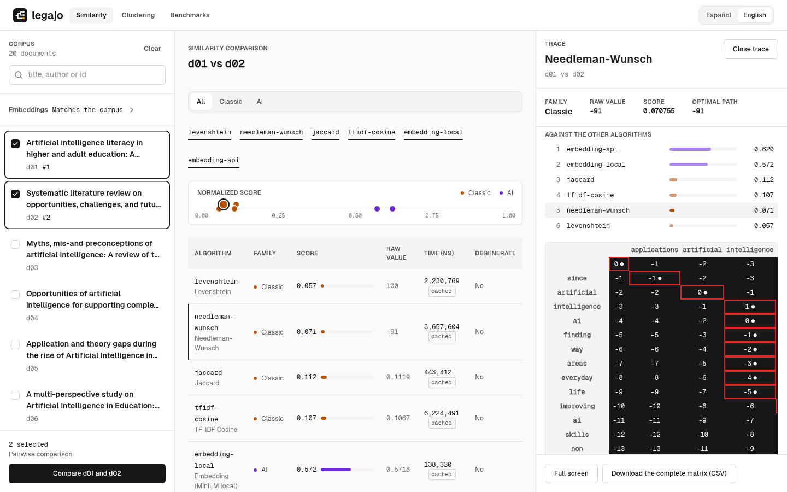
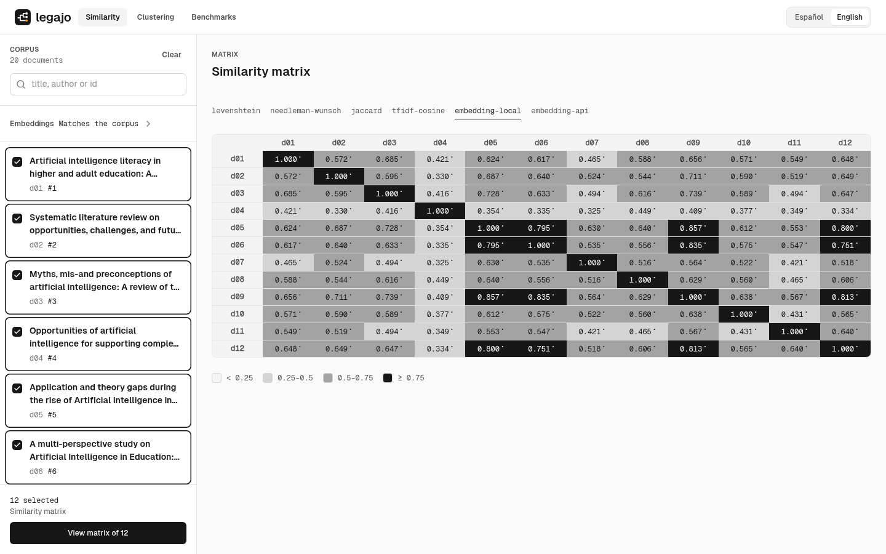
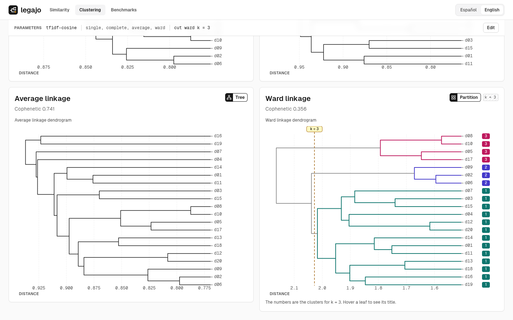
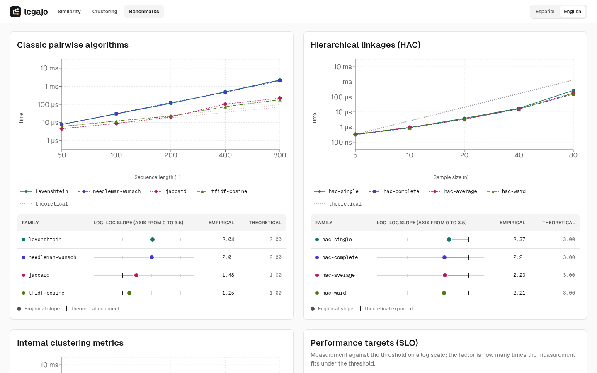
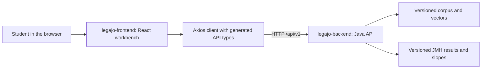

<!-- markdownlint-disable-next-line MD041 -->
<div align="center">

<h1>Legajo · Web App</h1>

<p><strong>A workbench for students to see how text similarity and clustering work on research abstracts.</strong></p>

<p>
<a href="https://github.com/diegnghtmr/legajo-frontend/actions/workflows/frontend.yml"></a>


<a href="LICENSE"></a>
</p>

<p>
<a href="https://diegnghtmr.me/en/work/legajo/"><strong>Case study</strong></a> &bull;
<a href="#quick-start"><strong>Quick start</strong></a> &bull;
<a href="#architecture"><strong>Architecture</strong></a> &bull;
<a href="https://github.com/diegnghtmr/legajo-backend"><strong>Backend repo</strong></a>
</p>

</div>

<p align="center"></p>

A similarity score alone does not explain why two abstracts match. Legajo shows the score and its trace together, then lets you compare other methods or see how a change in linkage groups the same corpus. The browser renders the results returned by the API rather than implementing its own algorithms.

## Features

- **Pairwise comparison.** Rank a pair of abstracts across six similarity capabilities and inspect method-specific traces.
- **Similarity matrix.** Select three or more documents and view their pairwise scores for one method at a time.
- **Hierarchical clustering.** Compare single, complete, average, and Ward dendrograms, inspect internal metrics, and cut a tree into a chosen number of groups.
- **Benchmark curves.** View versioned JMH runtimes and measured slopes alongside theoretical complexity; the page does not run JMH.
- **Bilingual interface.** Use the workbench in English or Spanish and inspect the embedding provider status.

## Preview



Choose abstracts from the reference corpus; darker cells indicate higher similarity.



Compare two trees side by side and cut one into a fixed number of clusters.



The benchmark page charts the CSV exports checked into the backend.

## Quick start

Install Docker **29+** and Docker Compose. No host Node installation is needed for the container workflow; Node **24 LTS** is pinned for editor tooling.

```sh
git clone https://github.com/diegnghtmr/legajo-frontend.git
git clone https://github.com/diegnghtmr/legajo-backend.git
cd legajo-backend
LEGAJO_FRONTEND_DIR=../legajo-frontend docker compose up -d --build --wait
```

Open <http://localhost>. The backend listens on <http://localhost:8080>; the default stack uses precomputed vectors and does not require an embedding API key. To build and serve only this repository's image with an already-running backend, run the following from the frontend root:

```sh
docker build --build-arg VITE_API_BASE_URL=http://localhost:8080 -t legajo-frontend:local .
docker run --rm -p 80:8080 legajo-frontend:local
```

| Variable               | Purpose                                                                                            | Default                                                                                      |
| ---------------------- | -------------------------------------------------------------------------------------------------- | -------------------------------------------------------------------------------------------- |
| `VITE_API_BASE_URL`    | Browser-reachable API URL embedded at build time; it cannot change when the container starts.      | Required explicitly for a standalone image; backend Compose supplies `http://localhost:8080` |
| `LEGAJO_FRONTEND_DIR`  | Frontend build context read by the backend Compose file.                                           | `../frontend`                                                                                |
| `LEGAJO_FRONTEND_PORT` | Host port published by the backend Compose file for the frontend. The container listens on `8080`. | `80`                                                                                         |

The image build rejects a missing or empty API argument and interior whitespace; surrounding whitespace is trimmed. In Vite development, an empty `VITE_API_BASE_URL` uses the `/api` proxy to `http://localhost:8080` instead.

### Deployment

The [web app on Vercel](https://legajo-frontend.vercel.app) points to the [API on Render](https://legajo-backend.onrender.com). The first API request after inactivity can take tens of seconds; use `/actuator/health` on the API before a live walkthrough. The backend must explicitly allow the browser origin. [vercel.json](vercel.json) allows Git deployments for `main` only and rewrites SPA routes to `/index.html`; the production project uses `main` with preview branch tracking disabled. That does not prevent manual previews. The container serves the same SPA fallback through [nginx.conf](nginx.conf).

## Architecture

React routes and feature components display the corpus, matrices, traces, trees, and charts. The backend owns the algorithms and returns the same scores, traces, and metrics regardless of client. The browser does not accept PDF uploads for ingestion.



### Contract workflow

The backend owns the OpenAPI contract; [contract/openapi-legajo.yaml](contract/openapi-legajo.yaml) is the checked-in copy. In a workspace where the backend is `../backend`, refresh it with `scripts/npm-in-docker.sh run api:sync`, then run `scripts/npm-in-docker.sh run api:types` and include the regenerated [api.ts](src/shared/types/api.ts) with the contract change. Do not edit it by hand; CI regenerates it and checks for a diff.

## Tech stack

| Layer               | Technology                                                               |
| ------------------- | ------------------------------------------------------------------------ |
| Application         | React 19.3, TypeScript 5.9 strict, React Router, TanStack Query, Zustand |
| Interface           | Tailwind CSS 4 with CSS-first `@theme`, Recharts, i18next                |
| Build and serving   | Vite 8, Node 24, nginx-unprivileged                                      |
| Contract and checks | Axios, `openapi-typescript`, Vitest 4, Testing Library, Playwright, axe  |

## Testing

### Checks run in containers

```sh
scripts/npm-in-docker.sh ci
scripts/npm-in-docker.sh run format:check
scripts/npm-in-docker.sh run lint
scripts/npm-in-docker.sh run typecheck
scripts/npm-in-docker.sh run check:tokens
scripts/npm-in-docker.sh run test:coverage
scripts/e2e-in-docker.sh
```

The npm wrapper uses the pinned Alpine Node image. The mocked Playwright suite uses a separate Ubuntu image and a separate `node_modules` volume because native dependencies cannot be shared across libc implementations. `run test` omits coverage; `run format` rewrites files and `run preview` serves a prior build. The production build and API URL guard can be checked by building the image as shown above.

### Full-stack E2E (no mocks)

With the sibling backend checkout available, run from this repo:

```sh
LEGAJO_BACKEND_DIR=../legajo-backend scripts/e2e-fullstack-in-docker.sh
```

The wrapper defaults to `../backend`; it starts the stack from the backend Compose file, runs Playwright against the real 20-document corpus, and tears the stack down on exit. The suite cross-checks actual scores and cluster membership, and a guard rejects API interception. The wrapper only reclaims a stale Compose project when its host and PID namespace labels match, the labeled PID is gone, and all three labels are present.

### Image smoke test

With the frontend image already running:

```sh
docker run --rm --network host -v "$PWD":/workspace:ro -w /workspace \
  curlimages/curl:8.15.0 sh scripts/smoke-image.sh http://localhost
```

The check has a 30-second readiness budget. It verifies response headers, SPA fallback on deep routes, `no-cache` on HTML, and long caching for hashed assets. [CI](.github/workflows/frontend.yml) also runs the dependency, format, lint, type, token, coverage, build, contract drift, and mocked browser checks; independent jobs cover the image, the [shell helper tests](scripts/tests/), and real-stack E2E. The stale-project helper test skips the `hidepid=2` case where private mounts are unsupported; CI sets `LEGAJO_STALE_RECLAIM_REQUIRE_HIDEPID=1` to require it.

## Documentation

- [Frontend reference](docs/frontend-reference.md) — script catalog, image and real-stack validation, API environment, and Vercel Git deployment policy.

## Related repositories

- [legajo-backend](https://github.com/diegnghtmr/legajo-backend) — similarity and clustering algorithms, corpus ingestion, and benchmark exports.

## License

Released under the [MIT License](LICENSE).
